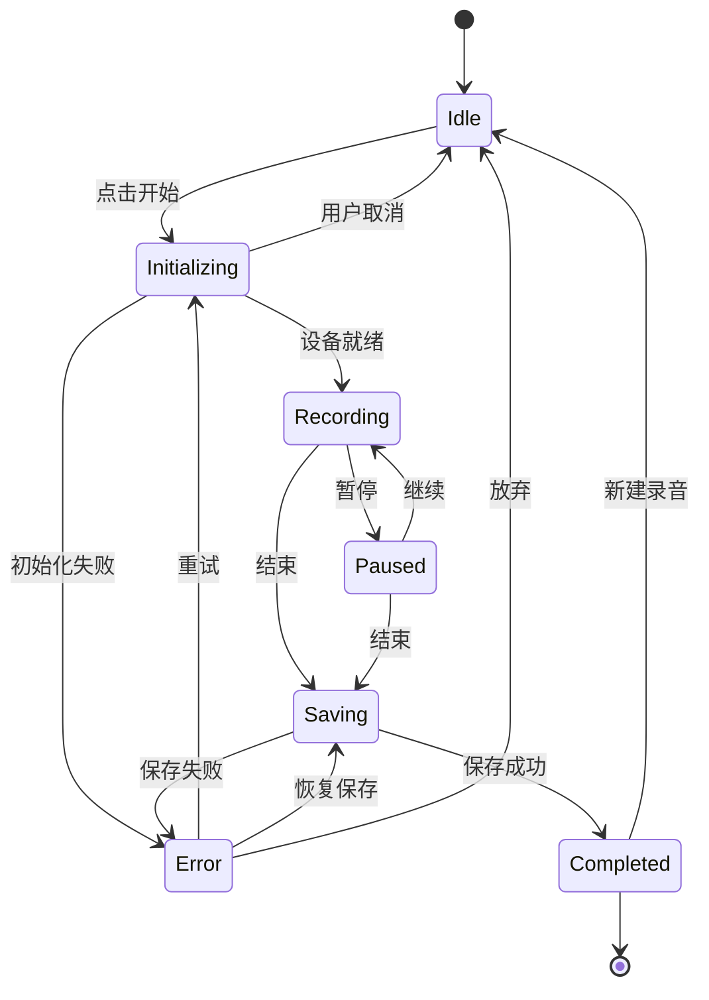

# Workspace UI V1.0 详细设计规格

> 状态：设计规格（待评审），作为进入实现前的最后一份 UI 契约  
> 上游需求：[AI 录音工作台 UI/UX 需求](AI录音工作台-UIUX需求.md)  
> 视觉基线：[视觉风格 v7：极光玻璃](视觉风格-v7-极光玻璃.md)、[UI 设计规范](UI设计规范.md)  
> 现有布局：[录音页面布局需求](录音页面布局需求.md)  
> 适用范围：`apps/desktop` Tauri v2 + Vanilla TypeScript  
> 更新日期：2026-11-08

## 0. 规格摘要

本规格锁定上游需求中要求先确定的三件事：

1. **录音控制面板的宽度、配置层级和状态变化**
2. **实时转录与 AI 洞察的空间关系**
3. **录音中、暂停时、结束后三种主要交互状态**

同时给出实现所需的组件清单、数据契约、状态机、键盘映射与验收标准。

### 0.1 已决策事项

| 编号 | 决策 | 说明 |
|---|---|---|
| D1 | 默认窗口 1220 × 900，最小 960 × 640 | 延续现有桌面端约束 |
| D2 | ≥ 1200 px 为三栏；1100–1199 为三栏窄版；< 1100 右侧洞察改为抽屉 | 保证转录最小可读宽度 |
| D3 | 左栏固定 288 px（1220 基准），不提供拖拽 | 降低 V1 复杂度，配置层级用折叠解决 |
| D4 | 右栏可拖拽 280–400 px，可折叠为 56 px 轨道 | 满足“可折叠、可调宽、独立展开” |
| D5 | 录音中左栏自动收起配置，只保留场景摘要、录音卡与电平 | 把空间让给状态与控制 |
| D6 | 转录与洞察共享同一 segment ID / 时间范围 | 引用跳转必须精确到片段与音频位置 |
| D7 | AI 决策、任务默认“待确认”，确认后才进入正式记录 | 防止 AI 结论污染知识库 |
| D8 | 复盘工作区复用五视图组件，不另写一套内容渲染 | 控制实现成本 |
| D9 | V1 不做实时说话人分离，沿用 ASR 返回的说话人编号 | 与 V1.0 范围表一致 |
| D10 | 知识中心 V1 仅保留导航入口与空态 | 不实现跨录音搜索 |

### 0.2 不可突破的约束

- 页面不出现整页滚动条，滚动只发生在左栏配置区、中间内容区与右侧洞察区。
- 录音中 AI 失败不得中断录音、不得阻塞音频写入。
- 波形与电平不得使用静态假数据；未接入时显示“未接入”而非伪造动画。
- 新转录到达时不得强制改变用户正在阅读的位置。
- AI 推断不得使用与原始事实相同的视觉权重。
- 玻璃模糊只用于中间与右侧两块主面板；左栏为高不透明实色面板，避免第三层 `backdrop-filter`。

## 1. 设计基准

### 1.1 应用外壳

```text
┌──────────────────────────────────────────────────────────────────────────────┐
│  App Bar 56px                                                                │
├──────────────────────────────────────────────────────────────────────────────┤
│                                                                              │
│  Workspace 区域：calc(100vh - 56px)，页面内边距 20 / 24                       │
│                                                                              │
└──────────────────────────────────────────────────────────────────────────────┘
```

| 项 | 规格 |
|---|---|
| App Bar 高度 | `56 px`，固定，不随内容滚动 |
| 背景 | `rgba(255,255,255,.72)` + `backdrop-filter: blur(18px)`，底部 `1px --ui-line` |
| 品牌区 | 图标 24 + “MagneticTape” 15 px / 650，左侧 24 px |
| 导航 | 工作台、历史录音、知识中心、设置；13 px / 500，间距 4 px |
| 导航项 | 高 32 px，左右 12 px，圆角 10 px；选中态 `--ui-primary-soft` + `--ui-primary-hover` 文字 |
| 右侧 | “本地保存”胶囊 + 设置图标按钮 32 × 32 |
| 拖拽区 | App Bar 空白处可拖拽窗口；交互控件区域设置 `-webkit-app-region: no-drag` |

导航使用 `role="navigation"`；当前项使用 `aria-current="page"`。历史录音、知识中心、设置复用同一 App Bar，仅切换主区域。

### 1.2 断点与三栏尺寸

页面外层使用 CSS Grid：

```css
.workspace-grid {
  display: grid;
  grid-template-columns: var(--ws-left) minmax(0, 1fr) var(--ws-right);
  gap: var(--ws-gap);
  height: calc(100vh - 56px);
  padding: var(--ws-pad-y) var(--ws-pad-x);
}
```

| 断点 | 页边距（上下 / 左右） | 左栏 | 右栏 | 栏间距 | 中间最小宽度 |
|---|---|---|---|---|---|
| ≥ 1440 px | 20 / 24 | 300 | 320 | 20 | 560 |
| 1200–1439 px | 20 / 24 | 288 | 304 | 16 | 520 |
| 1100–1199 px | 16 / 16 | 272 | 280 | 12 | 480 |
| 960–1099 px | 12 / 16 | 248 | 抽屉 360（默认隐藏） | 12 | 420 |

计算校验（1220 × 900）：

```text
可用宽度 = 1220 - 24 × 2 = 1172
中间宽度 = 1172 - 288 - 304 - 16 × 2 = 548
面板高度 = 900 - 56 - 20 × 2 = 804
```

右栏拖拽范围 `280–400 px`；拖拽时中间宽度不得低于当前断点的最小值。达到最小值后停止继续增宽，而不是压缩中间内容。

### 1.3 间距、圆角与字号

基础间距为 4 px 网格：4 / 8 / 12 / 16 / 20 / 24 / 32。

| 元素 | 圆角 | 说明 |
|---|---|---|
| App Bar 胶囊 / 控件 | 10–12 px | 导航、按钮、输入 |
| 左栏面板 | 24 px | 实色面板 |
| 中间 / 右侧面板 | 26 px | 玻璃主面板 |
| 洞察卡片 | 16 px | 内部内容块 |
| 录音卡 | 20 px | 左栏核心卡 |
| 状态标签 | 999 px | 胶囊 |

| 层级 | 字号 / 行高 | 字重 | 用途 |
|---|---|---|---|
| 计时 | 38 / 1.05 | 650，等宽数字 | 录音卡计时 |
| 页面标题 | 22 / 1.3 | 650 | 复盘标题 |
| 面板标题 | 15 / 1.4 | 650 | 内容区标题 |
| 区块标题 | 12.5 / 1.4 | 600 | 洞察分类、配置分组 |
| 转录正文 | 15 / 1.75 | 400 | 主要阅读文本 |
| 正文 | 14 / 1.65 | 400 | 摘要、问答 |
| 辅助 | 12 / 1.5 | 400 | 时间戳、说明 |
| 微标签 | 10.5 / 1.3 | 550 | 徽标、置信度 |

字体栈沿用 `"Segoe UI Variable", "Segoe UI", "Microsoft YaHei UI", sans-serif`；时间戳与计时使用 `font-variant-numeric: tabular-nums`。

### 1.4 层级与材质

```text
极光画布
├── App Bar（玻璃，blur 18）
├── 左栏 Control Panel（实色 rgba(255,255,255,.88)，无 blur）
├── 中间 Content Workspace（玻璃，blur 24）
└── 右侧 Insight Panel（玻璃，blur 24）
```

- 中间与右侧是仅有的两块大面积模糊面板。
- 左栏用 88% 白实色 + 1 px 内高光，保证在白底上仍可读。
- 内层卡片、按钮、输入一律实色或半实色，不叠加模糊。
- 关闭 `backdrop-filter` 时，面板必须回退为 `#FFFFFF` / `#FBFCFE`，层级仍可辨认。

## 2. 三栏总览

### 2.1 1220 × 900 线框

```text
┌──────────────────────────────────────────────────────────────────────────────────────┐
│ ◆ MagneticTape    工作台   历史录音   知识中心   设置              本地保存    ⚙     │ 56
├──────────────────────────────────────────────────────────────────────────────────────┤
│ 20                                                                                   │
│ ┌── 288 ─────────────┐ 16 ┌── 548 ───────────────────────────┐ 16 ┌── 304 ─────────┐ │
│ │ 录音场景        ⌄   │    │ 产品技术架构讨论      ● 录音中 02:13│    │ AI 洞察     ✦  ⟩ │ │
│ │ [会议][学习][灵感]  │    │ [转录][翻译][AI分析][任务][对话]  │    │ 当前主题          │ │
│ │ [访谈][电话][自由]  │    │ ─────────────────────────────── │    │ 技术架构讨论       │ │
│ │                     │    │ ● 发言人 01  00:03:12   96%      │    │ ─────────────    │ │
│ │ ▸ 语音配置  中文     │    │ 今天主要讨论项目的技术架构和下一   │    │ 关键观点          │ │
│ │ ▸ 音频配置  双通道   │    │ 阶段的开发计划。                  │    │ 系统稳定性优先     │ │
│ │ ▸ AI 配置   MiniMax │    │                                 │    │ 00:03:12–00:03:28 │ │
│ │                     │    │ ● 发言人 02  00:03:28   已编辑    │    │ ─────────────    │ │
│ │                     │    │ 我认为需要优先解决现有系统的稳定   │    │ 决策事项 待确认    │ │
│ │ ┌─────────────────┐ │    │ 性问题。                        │    │ 先解决稳定性       │ │
│ │ │ RECORDING       │ │    │                                 │    │ ─────────────    │ │
│ │ │ 00:12:35        │ │    │ ◌ 正在识别下一段语音……           │    │ 待办事项          │ │
│ │ │ 正在录音·本地保存 │ │    │                                 │    │ 制定优化方案       │ │
│ │ │ [暂停]   [结束]  │ │    │                                 │    │ 负责人待确认       │ │
│ │ │ 麦克风 正常 ▁▃▅▇  │ │    │                                 │    │ ─────────────    │ │
│ │ │ 系统   正常 ▁▂▄▆  │ │    │                     [回到最新 3] │    │ 待确认问题        │ │
│ │ └─────────────────┘ │    │                                 │    │ 验收指标是什么？   │ │
│ └─────────────────────┘    └─────────────────────────────────┘    └──────────────────┘ │
│                                                                                      │
└──────────────────────────────────────────────────────────────────────────────────────┘
```

### 2.2 1440 × 900 线框（右栏展开、间距加大）

```text
┌ 300 ───────────────┐  20  ┌── 732 ───────────────────────────────┐  20  ┌── 320 ──────────┐
│ 场景与配置          │      │ 标题区 / Tab / 转录                    │      │ AI 洞察          │
│                     │      │ 转录正文最大宽度 760，行高 1.75        │      │ 卡片内边距 16     │
└─────────────────────┘      └───────────────────────────────────────┘      └──────────────────┘
```

中间正文不铺满整栏：`max-width: 760px`，左对齐；超出部分留白，避免超长行影响阅读。

### 2.3 1100 × 800 线框（右栏收窄）

```text
┌ 272 ─────────────┐ 12 ┌────────── 492 ──────────┐ 12 ┌ 280 ────────┐
│ 场景 / 配置 / 录音 │    │ 标题 / Tabs / 转录       │    │ AI 洞察      │
│ 录音时配置区滚动   │    │ 正文 14.5 px / 1.7 可读  │    │ 卡片 14 px 内边距│
└───────────────────┘    └─────────────────────────┘    └──────────────┘
```

1100–1199 区间允许右栏直接收起为 56 px 轨道，给转录让出空间；展开后中间宽度不得低于 480 px。

### 2.4 960 × 640 线框（洞察改为抽屉）

```text
┌ 248 ────────┐ 12 ┌────────────── 668 ──────────────────┐
│ 场景 / 配置  │    │ 标题 / Tabs / 转录                   │
│             │    │                                     │
│ 录音卡贴底   │    │                                     │
└─────────────┘    └─────────────────────────────────────┘
                                             [✦ AI 洞察] ← 浮动按钮，唤出 360 px 抽屉
```

- 窗口高度不足 720 px 时，左栏隐藏实时波形条（高度优先让给电平与按钮），计时字号降为 32 px。
- 抽屉打开时覆盖右侧内容，允许遮罩，但按 `Esc` 必须立即关闭；打开时暂停自动滚动，关闭后恢复。
- 960 px 下右栏不作为常驻列，避免转录宽度低于 420 px。

## 3. 左侧控制面板

### 3.1 结构与尺寸

```text
┌ 288，padding 20，圆角 24 ─────────────┐
│ A. 场景选择区（固定，约 184）           │
│ B. 配置折叠区（可滚动，flex: 1）        │
│ C. 录音卡（固定贴底，约 244）           │
│ D. 底部状态行（本地保存 / 设备状态）     │
└───────────────────────────────────────┘
```

- 面板背景 `rgba(255,255,255,.88)`，1 px `rgba(255,255,255,.92)` 内高光，阴影 `0 18px 48px rgba(31,45,79,.08)`。
- 内部左右内边距 20 px；区块间距 12 px。
- B 区独立滚动，滚动条宽 6 px，默认透明，悬停显示。
- C 区不受 B 区滚动影响；窗口高度 < 720 px 时录音卡切换紧凑规格。

### 3.2 场景选择

```text
录音场景                              会议 ▾
┌─────────┐ ┌─────────┐ ┌─────────┐
│  ⊙ 会议  │ │  ◇ 学习  │ │  ✦ 灵感  │
└─────────┘ └─────────┘ └─────────┘
┌─────────┐ ┌─────────┐ ┌─────────┐
│  ◇ 访谈  │ │  ☎ 电话  │ │  ● 自由  │
└─────────┘ └─────────┘ └─────────┘
会议：多人讨论、纪要生成
```

| 项 | 规格 |
|---|---|
| 标题 | 12.5 px / 600，`--ui-ink`；右侧显示当前场景名 11.5 px |
| 网格 | 3 列 × 2 行，间距 8 px，单元格 `77 × 60 px` |
| 单元格 | 圆角 14 px，实色 `rgba(255,255,255,.7)`，1 px `--ui-line` |
| 图标 | 16 px，位于标签上方，间距 6 px |
| 标签 | 12 px / 550，选中时 `--ui-primary-hover` |
| 选中态 | 背景 `--ui-primary-soft`，边框 `rgba(18,132,86,.28)`，左上角 6 px 圆点 |
| 说明行 | 11.5 px，`--ui-muted`，单行截断，位于网格下方 8 px |
| 窄栏适配 | 1100 px 以下单元格宽度自适应，最小 60 px；标签不换行 |
| 键盘 | 方向键在网格内移动，`Enter` 选择；`roving tabindex` |

录音开始后网格收起为一行“场景：会议”摘要，点击仅在暂停时允许更换；录音中点击提示“结束后可更换场景”。

### 3.3 配置折叠区

```text
▾ 语音配置                     中文 · 不翻译
   语言识别        [自动识别 ⌄]
   翻译目标        [不翻译 ⌄]
   实时字幕        [开关]
▸ 音频配置                     麦克风 · 系统声音
▸ AI 配置                      MiniMax · 已连接
```

| 项 | 规格 |
|---|---|
| 分组头 | 高 40 px，字号 12.5 / 600；右侧摘要 11 px `--ui-muted` |
| 展开图标 | Chevron 14 px，旋转 180° 过渡 160 ms |
| 内容内边距 | 上下 4 px，左右 2 px；行高 36 px |
| 分隔 | 分组间 1 px `--ui-line`，左右缩进 2 px |
| 展开高度 | 语音约 128 px，音频约 128 px，AI 约 156 px |
| 默认状态 | 语音展开；音频、AI 收起 |
| 持久化 | 每个分组的展开状态写入 `localStorage` |

内容项：

| 分组 | 字段 | 控件 | 录音中行为 |
|---|---|---|---|
| 语音 | 语言识别 | Select | 变更需确认并重启 ASR 流 |
| 语音 | 翻译目标 | Select | 可变更，仅影响后续片段 |
| 语音 | 实时字幕 | Switch | 可随时开关 |
| 音频 | 麦克风 | Select | 禁用，提示“录音中不可切换” |
| 音频 | 系统声音 | Select | 禁用 |
| 音频 | 采样率 / 格式 | 只读摘要 | 只读 |
| AI | 模型 | Select | 可切换，新片段使用新模型 |
| AI | API Key | 掩码状态 + “配置”按钮 | 打开独立弹窗，不在左栏明文 |
| AI | 实时分析频率 | Select：关闭 / 30 秒 / 60 秒 / 2 分钟 | 可变更 |
| AI | 提示词 | “查看/编辑”入口 | 录音中只读，结束后可调 |

AI 配置收起时摘要必须包含模型名与连接状态，避免用户误以为未启用。

### 3.4 录音卡

```text
┌ 244（紧凑 204），padding 16 ─────────────┐
│ RECORDING                     ● 本地保存  │ 14
│ 00:12:35                                 │ 40
│ 正在录音 · 本地安全保存                    │ 16
│ ┌─────────────────┐ ┌─────────────────┐  │
│ │    ⏸ 暂停        │ │    ■ 结束        │  │ 40
│ └─────────────────┘ └─────────────────┘  │
│ ▁▂▃▅▇▆▄▃▂▁▂▄▆▇▅▃▂▁▂▃▅▇▆▄▃▂▁▂▄▆▇▅▃▂▁       │ 40
│ 麦克风   正常   ▁▃▅▇▅▃▁                  │ 20
│ 系统     正常   ▁▂▄▆▄▂▁                  │ 20
└──────────────────────────────────────────┘
```

| 元素 | 规格 |
|---|---|
| 卡背景 | 白色 92%，圆角 20，1 px `--ui-line`，内高光 |
| 状态标签 | 11 px / 600，字距 .04em；状态点颜色与动画见下表 |
| 计时 | 38 px / 650，等宽数字，`--ui-ink` |
| 状态文案 | 12 px，必须同时包含录音状态与保存状态 |
| 按钮 | 高 40 px；暂停为 `--ui-primary-soft` 底、`--ui-primary-hover` 字；结束为中性浅灰底、`--ui-danger` 字 |
| 波形 | 高 40 px，Canvas；按 RMS 绘制，30 fps；暂停时冻结 |
| 电平行 | 标签 11 px，状态 11 px / 600，电平条 72 × 6 px |
| 紧凑模式 | < 720 px 高度：隐藏波形，计时 32 px，卡高约 204 px |

状态视觉：

| 状态 | 标签 | 点 | 计时 | 波形 |
|---|---|---|---|---|
| Initializing | INITIALIZING | 灰，呼吸 | `00:00` | 静态弱化 |
| Recording | RECORDING | 红点，1.6 s 呼吸 | 递增 | 活动 |
| Paused | PAUSED | 琥珀，常亮 | 冻结 | 冻结 40% 对比 |
| Saving | SAVING | 绿，旋转描边 | 冻结 | 隐藏 |
| Error | ERROR | 红，常亮 | 冻结 | 隐藏 |

> 录音状态使用红点表达“正在采集”，与停止按钮的红色语义区分：红点直径 6 px，不承载点击。

### 3.5 底部状态行

- 高 24 px，字号 10.5 px，`--ui-muted`。
- 内容：`本地保存 · 已写入 42 个分片` / `设备：麦克风 + 系统声音`。
- 录音异常时替换为可点击的“查看详情”，点击展开错误说明与重试入口。
- 不在此处放设置入口，设置统一放在 App Bar。

## 4. 中间内容工作区

### 4.1 容器

| 项 | 规格 |
|---|---|
| 面板 | 玻璃 26 px，`rgba(255,255,255,.66)` + blur 24 px，内高光 + 阴影 |
| 高度 | 撑满 Workspace 区域，内部 `display:flex; flex-direction:column` |
| 头部 | 60 px，左右内边距 24 px |
| Tab 栏 | 44 px，左右内边距 20 px，底部 1 px `--ui-line` |
| 内容区 | `flex:1; overflow-y:auto; padding: 8px 24px 20px` |
| 底部渐隐 | 内容区底部 24 px 白色渐变，避免文字硬切 |

### 4.2 头部

```text
产品技术架构讨论                         ● 录音中   00:12:35      [搜索] [导出] [⋯]
```

| 元素 | 规格 |
|---|---|
| 标题 | 16 px / 650；点击进入编辑，`Enter` 保存 / `Esc` 取消 |
| 状态胶囊 | 高 24 px，11 px / 600；录音中绿底绿字，暂停琥珀，保存中灰，错误红 |
| 计时 | 12 px 等宽，`--ui-muted`；与录音卡计时同源 |
| 操作 | 图标按钮 28 × 28，间距 4；导出在主操作区使用文字按钮 |
| 窄容器 | 宽度 < 520 px 时隐藏计时，保留状态胶囊 |

### 4.3 Tab 导航

```text
[ 转录 128 ] [ 翻译 ] [ AI 分析 3 ] [ 任务 2 ] [ AI 对话 ]
────────────────────────────────────────────────────────
```

| 项 | 规格 |
|---|---|
| 单个 Tab | 高 32 px，左右 12 px，圆角 10 px，字号 13 / 550 |
| 默认态 | 文字 `--ui-muted`，透明底 |
| 悬停 | 文字 `--ui-ink`，底 `rgba(255,255,255,.55)` |
| 选中 | 文字 `--ui-ink`，底 `rgba(255,255,255,.92)`，阴影 0 2px 8px rgba(31,45,79,.06) |
| 计数徽标 | 高 16 px，最小宽 16 px，10.5 px，Iris 浅底；仅任务与待确认洞察显示 |
| 键盘 | `←/→` 切换，`Home/End` 首尾，`role=tablist` + `aria-selected` |
| 快捷键 | `Alt+1..5` |
| 持久化 | 当前 Tab 按 session 存储；重新打开同一录音恢复上次 Tab |

Tab 选中态不使用 Iris，避免整条导航被 AI 色彩占据；AI 语义由图标、内容徽标与操作按钮表达。

### 4.4 转录片段

#### 结构

```text
┌ 内容宽 500（1220 基准）──────────────────────────────┐
│ ● 发言人 01    00:03:12    已完成    96%             │ 22
│ 今天我们需要确定下一阶段的技术方案。                  │ 27
│ [▶ 播放] [编辑] [复制] [★ 重点]        ← 悬停显示     │ 28
│ ───────────────────────────────────────────────     │ 1
└─────────────────────────────────────────────────────┘
```

| 元素 | 规格 |
|---|---|
| 片段内边距 | `12 px 8 px 12 px 8 px`，片段间距 2 px，圆角 12 px |
| 说话人点 | 8 px 圆点，按说话人 ID 取粉彩颜色 |
| 说话人 | 12.5 px / 600 |
| 时间戳 | 11.5 px，等宽，`--ui-muted`；点击跳转音频 |
| 状态 | 10.5 px 胶囊：已完成（中性）/ 识别中（Iris 浅底）/ 已编辑（灰）/ 失败（红） |
| 置信度 | 10.5 px；≥ 98% 默认隐藏，< 98% 显示，< 85% 转为琥珀“低置信度 · 建议校对” |
| 正文 | 15 px / 1.75，`--ui-ink`；最多不限制行数，但不做逐字动画 |
| 翻译 | 13.5 px / 1.65，`--ui-iris-ink`，与原文间距 6 px |
| 悬停背景 | `rgba(255,255,255,.72)` |
| 当前播放片段 | 背景 `--ui-primary-soft` 60%，左侧 2 px `--ui-primary` 竖条 |
| 选中文本 | 允许原生选择；选择后浮动工具条“AI 解释 / 翻译 / 总结” |
| 固定片段 | 左侧 2 px 琥珀竖条 + 图钉图标，自动滚动时保持可见 |

窄栏适配：中间内容宽度 < 520 px 时，正文降为 14.5 px / 1.7，说话人行高 20 px，操作按钮仍保持 28 px 命中区。

#### 操作

| 操作 | 触发 | 行为 |
|---|---|---|
| 播放音频 | 点击时间戳 / 播放图标 | 定位到 `startMs`，播放至 `endMs` 后暂停；其他片段继续播放 |
| 编辑文本 | 双击正文 / 编辑按钮 | 原地切换 textarea，高 1.75 行高，`Ctrl+Enter` 保存，`Esc` 取消 |
| 复制 | 复制按钮 / `Ctrl+C`（未选中时） | 复制当前片段文本 + 时间戳 |
| 标记重点 | 星标按钮 | 切换 pinned，写入洞察“关键观点”候选 |
| 修改说话人 | 点击说话人 | 弹出说话人列表，支持重命名，应用到同 speakerId 后续片段（可撤销） |
| 删除片段 | `⋯` 菜单 | 二次确认，软删除并记录操作历史，可撤销 |
| AI 解释 | 选中文本后浮动条 | 打开右侧洞察抽屉的临时问答卡，带引用 |

#### 未完成片段

- 文案区最后一行显示 40 ms 周期低透明度呼吸（`opacity .72 → .92`），不做闪烁、不做位移动画。
- 末尾显示 6 px Iris 圆点 + “识别中”。
- 识别完成后 160 ms 内交叉淡入为正式文本，避免布局跳动：片段容器高度使用 `min-height` 预留两行。
- 未完成片段不参与导出、总结与全文复制。

#### 空态、加载态、错误态

| 状态 | 表现 |
|---|---|
| 未开始录音 | 居中插画 + “开始录音后，实时转录会显示在这里” + 开始按钮 |
| 初始化 | 3 行骨架 + “正在准备音频与识别服务……” |
| 录音中但无片段 | “正在聆听……请开始说话”，下方显示波形占位 |
| ASR 失败 | 顶部内联红色提示条 + “重试识别”；已有片段保留 |
| 本地 Whisper 未下载模型 | 明确提示去设置下载，不使用禁用按钮假装可用 |
| 搜索无结果 | “没有匹配的转录片段” + 清除搜索 |

### 4.5 其余四视图

#### 翻译视图

- 每行对应一个转录片段，不合并、不重排。
- 内容宽度 ≥ 640 px 时左右两列：原文 45%、译文 55%；< 640 px 上下排列。
- 原文 13.5 px `--ui-muted`，译文 14.5 px `--ui-ink`；译文块背景 `--ui-iris-soft` 40%，圆角 10 px。
- 翻译中显示行内骨架；失败显示“重试本段”，不影响其他行。

#### AI 分析视图

- 顶部为“分析范围”筛选：实时 / 最近 5 分钟 / 全段。
- 分区顺序：主题 → 关键观点 → 决策事项 → 争议与分歧 → 待确认问题。
- 每条卡片包含：标题、正文、认知标签、来源时间范围、置信度（推断类）。
- 新分析以 180 ms 淡入插入，不重排已读卡片；顶部出现“2 条新分析”提示。

#### 任务视图

```text
□ 完成系统稳定性优化方案         负责人待确认   截止待确认   00:04:10   [确认] [编辑] [忽略]
```

- 行高 56 px，复选框 16 px，左侧完成状态。
- 列：任务（可换行两行）、负责人、截止时间、来源、操作。
- 未确认任务行背景 `--ui-amber-soft` 30%，确认后转白。
- 批量确认需展开待确认列表，禁止一键静默确认。

#### AI 对话视图

- 消息区最大宽度 680 px，用户消息右对齐、AI 消息左对齐。
- AI 回答中的引用使用 `[00:03:12]` 胶囊，点击跳转并高亮片段。
- 输入框固定在视图底部，高 44 px，支持 `Enter` 发送、`Shift+Enter` 换行。
- 流式回答时逐段追加；用户上滚时暂停自动跟随，显示“回到最新”。
- 每个回答底部提供“复制 / 定位全部引用 / 反馈”。
- 无 API Key 或模型未配置时，输入框禁用并给出配置入口。

## 5. 右侧 AI 洞察

### 5.1 展开态

| 项 | 规格 |
|---|---|
| 宽度 | 304（1220）/ 320（≥1440）/ 280（1100–1199） |
| 面板 | 玻璃 26 px，blur 24，`rgba(255,255,255,.62)` |
| 头部 | 52 px，左右 16 px；标题 13 px / 650 + AI 胶囊 + 收起按钮 |
| 内容 | `overflow-y:auto`，左右 16 px，上下 8 px |
| 卡片 | 内边距 `14 px 0`，卡片间 1 px `--ui-line`，最后一张无分隔 |
| 滚动条 | 6 px，悬停显示 |

### 5.2 洞察卡片

```text
当前主题
AI 开发平台技术架构讨论

关键观点
系统稳定性应该优先于新功能开发。
[00:03:12–00:03:28]  [AI 总结]

决策事项
暂定先解决稳定性问题。
[待确认]  [确认] [编辑]

争议与分歧
目前尚未检测到明确分歧。

待办事项
制定系统稳定性优化方案。
负责人待确认 · 截止待确认

待确认问题
稳定性优化的验收指标是什么？
```

| 元素 | 规格 |
|---|---|
| 分类标题 | 12.5 px / 600，`--ui-muted`；左侧图标 14 px |
| 正文 | 14 px / 1.65，`--ui-ink`；最多 4 行，超出“展开” |
| 来源 | 11 px，时钟图标 + 时间范围；点击跳转 + 高亮 |
| 认知标签 | 见 5.3 |
| 操作 | 确认、编辑、忽略，文字按钮 11.5 px |
| 空态 | “当前还没有足够内容生成洞察”，不显示骨架超过 10 秒 |

### 5.3 事实与推断的视觉区分

| 类型 | 标签 | 背景 | 文字 | 边框 |
|---|---|---|---|---|
| 原始事实 | 原文 | `#F1F3F8` | `#5A6178` | 无 |
| AI 总结 | AI 总结 | `--ui-iris-soft` | `--ui-iris-ink` | 无 |
| AI 推断 | AI 推断 | 透明 | `--ui-iris-ink` | 1 px 虚线 `rgba(108,92,231,.45)` |
| 待确认 | 待确认 | `--ui-amber-soft` | `--ui-amber-ink` | 无 |
| 已确认 | 已确认 | `--ui-primary-soft` | `--ui-primary-hover` | 无 |

规则：

- 决策、任务、待办默认“待确认”，标签与确认按钮同时出现。
- “AI 推断”不得使用实底，避免与总结混淆；同时展示置信度或“推测”说明。
- “待确认问题”卡片不提供“确认”按钮，只能转为任务或忽略。
- 原始事实引用必须可点击定位；无来源的 AI 内容需标“无直接来源”。

### 5.4 更新行为

- 新洞察到达时，在对应分类顶部插入，旧卡片位置不下移超过 1 张卡的高度；用户正在阅读的卡片不得被替换。
- 面板头部显示 6 px Iris 圆点；折叠轨道显示未读数。
- 分析中显示顶部细进度条（2 px，Iris），不阻塞阅读。
- 分析失败显示“AI 分析已暂停”+ 重试；已有内容保留。
- 用户滚动离开顶部时，不强制滚回；显示“3 条新洞察”胶囊。

### 5.5 折叠态

- 宽度 56 px，与右栏同高，玻璃材质。
- 纵向排列：展开按钮、主题、观点、决策、待办、待确认，各 40 × 40，间距 4 px。
- 图标 18 px；悬停显示 tooltip 与条数；未读用 6 px 圆点。
- 点击图标展开面板并滚动到对应分类。
- 折叠状态持久化；快捷键 `Ctrl+Shift+I` 切换。

### 5.6 窄屏抽屉（< 1100 px）

- 宽 360 px，从右侧滑入，顶部 56 px，底部 0。
- 遮罩 `rgba(32,30,54,.24)`，点击遮罩或 `Esc` 关闭。
- 打开时焦点进入抽屉，关闭后回到触发按钮。
- 抽屉内卡片规格同展开态，内边距降为 14 px。
- 录音中打开抽屉不暂停录音，但暂停转录自动滚动。

## 6. 录音复盘工作区

### 6.1 页面结构

```text
┌ App Bar 56 ──────────────────────────────────────────────────────────────────┐
├──────────────────────────────────────────────────────────────────────────────┤
│ ← 返回   产品技术架构讨论                                   [导出] [⋯]        │ 64
│ 2026-11-08 · 42:18 · 4 位参与者 · 会议                                        │
├──────────────────────────────────────────────────────────────────────────────┤
│ ▶  ─────●────────────────────────  12:35 / 42:18   1.0×  音量               │ 64
├──────────────────────────────────────────────────────────────────────────────┤
│ ┌── 主内容 720 ─────────────────────────┐ 24 ┌── 侧栏 320 ──────────────┐    │
│ │ 摘要                                   │    │ 本次概览                  │    │
│ │ [AI 总结] ...                          │    │ 待确认 3 · 任务 2          │    │
│ │ 关键观点                               │    │ [确认待办]                │    │
│ │ 决策记录                               │    │ 章节导航                  │    │
│ │ 待办事项                               │    │ AI 对话入口               │    │
│ │ 完整转录（Tab / 折叠）                  │    │                           │    │
│ └────────────────────────────────────────┘    └───────────────────────────┘    │
└──────────────────────────────────────────────────────────────────────────────┘
```

| 项 | 规格 |
|---|---|
| 路由 | `#/recordings/:sessionId`，替代当前“历史详情”只读面板 |
| 页面最大宽 | 1120 px，居中；左右留白 ≥ 24 px |
| 头部 | 高 64 px；返回 32 × 32；标题 22 px / 650；元信息 12 px |
| 播放器 | 高 64 px，吸顶于头部下方；背景 `rgba(255,255,255,.82)` |
| 主体 | Grid：`minmax(0, 720px) 320px`，gap 24；< 1200 px 变单列 |
| 侧栏 | 吸顶，top 128 px；待确认队列优先 |
| 段落间距 | 32 px；每个区块标题 15 px / 650 + 说明 12 px |

### 6.2 播放器

- 播放/暂停 36 × 36 圆形按钮，绿色主操作。
- 后退/前进 10 秒，图标按钮。
- 进度条 6 px，已播绿色，缓冲灰色；悬停显示时间气泡。
- 时间 `12:35 / 42:18`，12 px 等宽。
- 倍速菜单：0.75 / 1.0 / 1.25 / 1.5 / 2.0。
- 音量按钮 + 滑块，滑块在空间不足时收进弹出层。
- 点击任意转录片段可 seek；播放时当前片段高亮并自动滚动，但用户手动滚动后暂停跟随。

### 6.3 内容区块

| 区块 | 组件 | 默认状态 | 确认要求 |
|---|---|---|---|
| 录音摘要 | 摘要卡 + “重新生成” | 展开 | 摘要整体可确认 |
| 关键观点 | 列表 + 来源 | 展开 | 单条确认 |
| 决策记录 | 决策卡，区分暂定/已确认 | 展开 | 必须确认 |
| 待办事项 | 任务表 | 展开 | 必须确认 |
| 完整转录 | 复用转录视图 | 折叠 / 独立 Tab | 不需确认，编辑即时生效 |
| AI 对话 | 复用对话视图 | 侧栏入口 | 不产生正式记录 |

“完整转录”不默认铺开，避免复盘页变成超长文本；提供“展开全文”与“在新 Tab 打开”。

### 6.4 AI 内容确认流程

```text
┌──────────────────────────────────────────────────────────────┐
│ 待办事项                                         3 条待确认   │
│ ┌──────────────────────────────────────────────────────────┐ │
│ │ □ 完成系统稳定性优化方案                                   │ │
│ │   来源 00:04:10  [AI 推断]  负责人：待确认  截止：待确认     │ │
│ │   [确认] [编辑] [忽略]                                    │ │
│ └──────────────────────────────────────────────────────────┘ │
│                                        [全部确认（需先展开）] │
└──────────────────────────────────────────────────────────────┘
```

| 操作 | 结果 | 后续 |
|---|---|---|
| 确认 | 状态变为“已确认”，记录确认时间 | 进入正式纪要、任务与知识库候选 |
| 编辑 | 打开行内编辑，保存后变为“已确认（已编辑）” | 保留原始 AI 输出与修改记录 |
| 忽略 | 从正式记录移除，来源片段保留 | 可在“已忽略”筛选中恢复 |
| 批量确认 | 仅对当前筛选结果生效，执行前展示清单 | 需二次确认 |

- 未确认内容在导出时默认排除；若用户选择包含，则标注“未确认”。
- 摘要中的决策与任务数量必须与待确认队列一致，避免“摘要说 3 条、队列只有 2 条”。
- 复盘页顶部显示确认进度：“已确认 5 / 8”。

### 6.5 响应式

- < 1200 px：单列；侧栏内容折叠为播放器下方的横向状态条 + “待确认 3”按钮。
- < 900 px：头部元信息换行；播放器倍速与音量收进菜单。
- 960 × 640 下，播放器保持 56 px，头部 56 px，主体可滚动。

## 7. 状态机与时序

### 7.1 录音状态机



### 7.2 三条独立状态线

界面不能把三条线合并成一个“处理中”：

| 状态线 | 取值 | 归属 | UI |
|---|---|---|---|
| Recorder | idle / initializing / recording / paused / saving / completed / error | 音频采集 | 录音卡、状态胶囊 |
| Save | clean / saving / saved / failed | 分片与元数据 | 底部状态行、保存提示 |
| AI | off / live / degraded / done / failed | 转写、翻译、分析 | 内容区进度、洞察头部 |

组合示例：

| Recorder | Save | AI | 用户看到 |
|---|---|---|---|
| Recording | saving | live | 正在录音，转录中；保存进度不打断阅读 |
| Completed | saved | live | 录音已保存，AI 仍在分析；可进入复盘 |
| Completed | saved | failed | 录音与转录可用，AI 分析失败可重试 |
| Error | failed | off | 录音异常；提供恢复与导出已有分片 |
| Paused | saved | live | 已暂停，AI 继续处理已提交片段 |

### 7.3 状态迁移表

| 当前 | 事件 | 下一状态 | 守卫 / 副作用 |
|---|---|---|---|
| Idle | start | Initializing | 检查设备与模型；禁用配置；创建 session |
| Initializing | ready | Recording | 启动采集、计时、实时 ASR；写 checkpoint |
| Initializing | cancel | Idle | 释放设备，删除空 session |
| Initializing | fail | Error | 记录原因；保留可重试入口 |
| Recording | pause | Paused | 停止写新分片，保留已写分片；计时冻结 |
| Paused | resume | Recording | 继续写分片；时间轴连续，不新增空洞 |
| Recording / Paused | stop | Saving | 幂等；禁用按钮；finalize 当前分片 |
| Saving | saved | Completed | 写 manifest；生成复盘入口；AI 可继续 |
| Saving | failed | Error | 保留已写分片；提供“重试保存”与“导出已有” |
| Error | retry | Initializing | 仅在设备可用且无未保存数据时 |
| Error | recover | Saving | 存在可恢复分片时优先恢复保存 |
| Completed | new | Idle | 清理视图状态，保留配置 |

### 7.4 关键时序

#### 开始录音

```text
用户点击开始
  → UI: Initializing，按钮禁用，配置禁用
  → 检查麦克风/系统输出设备
  → 打开音频流 + 创建会话目录 + 写初始 checkpoint
  → 启动 ASR/实时字幕（可失败，不阻塞录音）
  → UI: Recording，计时开始，左栏收起配置
```

要求：初始化超过 8 秒显示“仍在准备……”与取消按钮；失败必须给出具体原因（设备占用、权限、驱动）。

#### 结束录音

```text
用户点击结束
  → UI: Saving，暂停/结束按钮禁用
  → 停止采集 → finalize 分片 → 原子提交 checkpoint
  → 写 manifest / transcript 元数据
  → UI: Completed，显示“已保存 · 42:18”与“进入复盘”
  → AI 后处理独立继续（若未完成）
```

不在保存成功后自动跳转复盘页，避免打断用户；提供主按钮“进入复盘”。若用户 5 秒内未操作且无未确认内容，可显示轻量提示，不自动跳转。

#### 录音中 AI 失败

```text
AI 请求失败
  → 录音、音频写入、实时字幕继续
  → 内容区顶部内联提示“AI 分析已暂停”
  → 洞察面板显示重试
  → 指数退避重试；连续 3 次失败后停止自动重试
```

#### 崩溃恢复

```text
启动
  → 扫描未完成 session / checkpoint
  → 发现可恢复分片 → 顶部横幅“检测到未完成的录音（12:35）”
  → [恢复] → Saving → Completed
  → [忽略] → 标记 interrupted，保留文件供历史页处理
```

恢复过程不得自动覆盖已有文件；复用现有 `RecoveryManifest` / `RecoveryStore` 语义。

## 8. 交互与键盘

### 8.1 指针交互

| 区域 | 行为 |
|---|---|
| 左栏面板 | 不拖拽宽度；配置区可滚动 |
| 右栏左边缘 | 6 px 命中区，`col-resize`；悬停显示 2 px 高亮线 |
| 右栏折叠按钮 | 单击折叠为轨道；轨道顶部按钮恢复 |
| 转录片段 | 悬停显示操作；点击时间戳 seek；双击编辑 |
| 洞察来源 | 单击 seek + 高亮片段；`Ctrl+单击` 在新 Tab 打开复盘 |
| 任务行 | 复选框切换完成；确认/忽略不触发行选中 |

### 8.2 键盘映射

| 快捷键 | 作用域 | 行为 |
|---|---|---|
| `Space` | 全局（非输入态） | 暂停 / 继续录音 |
| `Ctrl+Enter` | 全局 | 结束录音（需二次确认） |
| `Alt+1..5` | 工作台 | 切换五个 Tab |
| `Ctrl+Shift+I` | 工作台 | 折叠 / 展开 AI 洞察 |
| `Ctrl+K` | 工作台 | 聚焦转录搜索 |
| `Esc` | 全局 | 关闭抽屉 / 退出编辑 / 取消选择 |
| `↑ / ↓` | 转录列表 | 上/下选中片段 |
| `Enter` | 转录列表 | 播放选中片段 |
| `Ctrl+E` | 选中片段 | 编辑文本 |
| `Ctrl+Shift+P` | 选中片段 | 标记 / 取消重点 |

输入框、文本域、下拉获得焦点时，除 `Esc` 外的全局快捷键不触发。快捷键需在设置页可查看，V1 不做自定义。

### 8.3 焦点顺序

1. App Bar 导航 → 右侧本地状态 / 设置
2. 左栏场景网格 → 配置分组头 → 展开项 → 暂停 → 结束
3. 中间头部操作 → Tab → 转录列表 / 当前视图内容
4. 右侧洞察头部 → 卡片操作 → 来源

- 右栏折叠后，轨道按钮进入 Tab 顺序，位置紧随中间内容之后。
- 抽屉打开时焦点进入抽屉，关闭后返回触发按钮。
- 所有异步状态通过 `aria-live="polite"` 播报；计时不逐秒播报。
- 拖拽分隔条使用 `role="separator"`、`aria-orientation="vertical"`、`aria-valuemin/max/now`，支持方向键调整。

## 9. 视觉令牌增量

以下令牌需在实现时补充进 [UI 设计规范](UI设计规范.md)：

```css
:root {
  /* 布局 */
  --ws-topbar-h: 56px;
  --ws-left: 288px;
  --ws-right: 304px;
  --ws-gap: 16px;
  --ws-pad-x: 24px;
  --ws-pad-y: 20px;
  --ws-center-min: 520px;

  /* 语义扩展 */
  --ui-amber: #b26a00;
  --ui-amber-soft: #fff3e2;
  --ui-amber-ink: #8a4b00;
  --ui-danger: #b3262e;
  --ui-danger-soft: #ffe8ea;
  --ui-fact-bg: #f1f3f8;
  --ui-fact-ink: #5a6178;
  --ui-focus-ring: rgba(18, 132, 86, .28);
  --ui-focus-ring-ai: rgba(108, 92, 231, .30);

  /* 组件 */
  --ws-radius-panel: 26px;
  --ws-radius-card: 20px;
  --ws-radius-control: 12px;
  --ws-shadow-panel: 0 24px 70px rgba(40, 45, 75, .09);
  --ws-shadow-card: 0 2px 8px rgba(31, 45, 79, .06);
}
```

使用规则：

- 琥珀只用于暂停、待确认、低置信度等“需要关注但不阻断”的状态。
- 红色只用于录音采集点、停止、错误与删除。
- 绿色用于本地、录音、确认、成功与主操作。
- Iris 用于 AI 生成、推断、翻译与 AI 主操作。
- 同一屏内琥珀、红色、Iris 不应同时大面积出现；徽标面积控制在 80 px 内。

## 10. 组件清单与工程映射

### 10.1 现有代码基础

当前前端为 Vanilla TypeScript，主要文件：

| 文件 | 现状 | 本次处理 |
|---|---|---|
| `apps/desktop/src/main.ts` | 页面装配、事件绑定、Tauri 调用 | 保留控制器职责，抽出工作台视图 |
| `apps/desktop/src/components.ts` | 模板渲染与视图更新 | 逐步拆分为工作台模块，保留现有导出 |
| `apps/desktop/src/styles.css` | 累积多轮样式，存在重复令牌 | 新增工作台区块，收敛重复令牌 |
| `apps/desktop/src/types.ts` | 已有 `TranscriptSegment`、`RecorderStatus` 等 | 增加视图模型，不破坏后端序列化 |
| `apps/desktop/src/player.ts` | 统一回放时间轴 | 复盘页复用 |

### 10.2 建议模块

```text
apps/desktop/src/
├── app-shell.ts                 # App Bar、导航、路由切换
├── workspace/
│   ├── workspace-view.ts        # 三栏装配
│   ├── workspace-state.ts       # 集中状态与派生选择器
│   ├── layout.ts                # 断点、右栏拖拽、折叠
│   ├── control-panel.ts         # 场景、配置、折叠
│   ├── recording-card.ts        # 计时、按钮、波形、电平
│   ├── workspace-tabs.ts        # Tab 与键盘
│   ├── transcript-view.ts       # 转录列表、自动滚动、编辑
│   ├── translation-view.ts
│   ├── analysis-view.ts
│   ├── tasks-view.ts
│   ├── chat-view.ts
│   ├── insight-panel.ts         # 卡片、确认、折叠轨道
│   ├── segment.ts               # 单片段渲染与操作
│   └── review-view.ts           # 复盘页装配
└── services/
    ├── workspace-prefs.ts       # 布局、Tab、折叠持久化
    └── scroll-follow.ts         # 自动跟随状态机
```

拆分原则：先抽视图与纯函数，再迁移事件绑定；`main.ts` 继续作为命令与事件总线，不允许视图模块直接调用 Tauri 命令。

### 10.3 数据契约

在现有 `types.ts` 上扩展视图模型，后端结构不变：

```ts
export type WorkspaceTab =
  | "transcript"
  | "translation"
  | "analysis"
  | "tasks"
  | "chat";

export type SegmentStatus = "final" | "partial" | "failed" | "edited";
export type Epistemic = "fact" | "summary" | "inference" | "pending" | "confirmed";

export interface TimelineSegment {
  id: string;
  startMs: number;
  endMs: number;
  speakerId: string;
  speakerName: string;
  text: string;
  translation?: string;
  status: SegmentStatus;
  confidence?: number;
  pinned?: boolean;
  active?: boolean;
}

export interface InsightItem {
  id: string;
  kind: "topic" | "point" | "decision" | "dispute" | "todo" | "question";
  title: string;
  body: string;
  epistemic: Epistemic;
  confidence?: number;
  source?: { startMs: number; endMs: number; segmentIds: string[] };
  confirmState: "pending" | "confirmed" | "ignored";
  edited?: boolean;
}

export interface WorkspaceLayoutState {
  rightWidth: number;
  rightCollapsed: boolean;
  activeTab: WorkspaceTab;
  followTranscript: boolean;
  configExpanded: Record<"voice" | "audio" | "ai", boolean>;
}
```

约束：

- `id` 由前端生成，格式 `seg-<startMs>-<index>`；后端未提供时按 startMs 派生。
- `source.segmentIds` 用于精确跳转；仅有时间范围时退化为 seek。
- 确认状态存放在本地会话数据中，不修改原始 AI 响应。
- 编辑后的文本写入 `transcript.json` 的对应片段，并保留原始文本副本。

### 10.4 持久化键

| 键 | 内容 | 作用域 |
|---|---|---|
| `mt.workspace.layout` | rightWidth、rightCollapsed | 全局 |
| `mt.workspace.tab` | 上次 Tab | 全局 |
| `mt.workspace.config` | 配置分组展开状态 | 全局 |
| `mt.workspace.scene` | 场景 | 全局 |
| `mt.session.<id>.follow` | 是否跟随 | 会话 |
| `mt.session.<id>.confirms` | 确认状态 | 会话 |

写入防抖 200 ms；非法值回退默认，不让坏数据导致布局崩溃。

### 10.5 性能预算

| 指标 | 预算 |
|---|---|
| 转录增量更新 | 批量合并，最多 8 次/秒；单次 DOM 变更 ≤ 20 个片段 |
| 长列表 | > 300 片段启用虚拟列表，DOM 节点 ≤ 600 |
| 波形绘制 | ≤ 30 fps；不可在滚动事件中读取布局 |
| 右栏拖拽 | 使用 `requestAnimationFrame`，不触发布局抖动 |
| 首屏 | 工作台骨架 ≤ 200 ms 出现，数据异步填充 |
| 内存 | 单会话 4 小时转录不因全量重渲染卡顿 |

## 11. 验收标准

### 11.1 布局

1. 1220 × 900 下三栏宽度为 288 / 548 / 304，间距 16，页面无整页滚动。
2. 1440 × 900 下左/右栏为 300 / 320，中间 ≥ 560。
3. 1100 × 800 下三栏均可读，右栏 ≥ 280，中间 ≥ 480。
4. 960 × 640 下为两栏 + 抽屉，无控件重叠、无横向滚动。
5. 右栏拖拽范围 280–400，达到中间最小宽度后停止，双击恢复默认。
6. 折叠右栏后，转录区扩展且不重排当前阅读位置。

### 11.2 录音状态

1. Idle → Initializing → Recording 的按钮、配置与文案符合状态表。
2. 录音中配置自动收起；暂停时保留暂停入口；结束后显示已保存状态。
3. 保存中与 AI 处理中分别可见，不合并为单一条。
4. AI 失败时录音与转录不中断，错误可重试。
5. 结束录音幂等，重复点击不产生第二个 session。
6. 崩溃恢复横幅可恢复未完成录音，且不覆盖已有文件。

### 11.3 转录与洞察

1. 自动跟随在用户上滚后停止，出现“回到最新”，回到底部后恢复。
2. 新片段到达不改变用户当前阅读位置；固定片段不被自动滚动带走。
3. 来源时间戳可跳转音频并高亮对应片段。
4. 事实、总结、推断、待确认四类标签视觉可区分，颜色不是唯一线索。
5. 决策与任务默认待确认，未确认内容不进入正式导出。
6. 洞察折叠/展开/调宽不丢失阅读位置与未读状态。

### 11.4 设计与工程

1. 所有新增颜色来自令牌，不散落十六进制值。
2. 玻璃模糊只出现在中间与右侧面板；左栏无 `backdrop-filter`。
3. 键盘可完成开始、暂停、结束、切换 Tab、折叠洞察与跳转片段。
4. 焦点环可见，文字对比度达到 WCAG AA。
5. 现有 Vitest 用例通过；新增状态机、跟随滚动、确认流程的单元测试。
6. `npm run build` 通过，浏览器模式 E2E 覆盖三栏布局与录音状态切换。

## 12. 评审检查表

进入实现前，设计评审需逐项确认：

- [ ] 1220 × 900 线框与本文尺寸一致，标注可量测。
- [ ] 960 × 640 下所有主要操作仍可到达。
- [ ] 右栏折叠轨道与抽屉两种形态均有线框。
- [ ] 录音中、暂停、保存中、完成、错误五种状态均有视觉稿。
- [ ] 转录片段悬停、选中、编辑、识别中、失败五种形态齐全。
- [ ] 事实/总结/推断/待确认四类标签在深色文字与浅色底上均清晰。
- [ ] 复盘页确认流程包含确认、编辑、忽略、批量确认。
- [ ] 交互动效尊重 `prefers-reduced-motion`。
- [ ] 所有尺寸与令牌标注完成，可直接进入组件实现。

## 13. 遗留与下一迭代

明确不在 V1.0 范围：

- 实时说话人分离与声纹识别（D9）。
- 跨录音知识搜索、知识图谱、多录音关联分析。
- 决策追踪与长期任务看板。
- 移动端布局；窗口最小宽度以下不做适配。
- 深色模式与国际化。

需要后续补充的规格：

- 真实设备异常（占用、拔线、休眠）在各状态的文案与恢复路径。
- AI 服务限流、超时、部分失败的细分提示。
- 录音结束后“进入复盘”的转场动画与未保存提醒。
- 导出面板的字段选择与未确认内容标注样式。
